# Multi-Vendor Marketplace

A marketplace where independent sellers sell fixed-price items and run auctions. One checkout creates a parent order that splits into one sub-order per seller, each with its own status flow, platform commission, refunds and payouts. Stock, bids and order statuses update live over WebSocket.

**Stack:** NestJS 11 + Prisma 7 + PostgreSQL 17, Meilisearch, Redis + BullMQ, Socket.IO, React 19 + TanStack Query + shadcn/ui (Feature-Sliced Design), Docker, GitHub Actions, k6.

## Quick start

```bash
cp .env.example .env
docker compose up --build
```

Migrations and demo data are applied automatically.

|         | URL                                                                         |
| ------- | --------------------------------------------------------------------------- |
| App     | http://localhost:5173                                                       |
| Swagger | http://localhost:3001/api/docs                                              |
| Metrics | http://localhost:3001/metrics (api), http://localhost:3002/metrics (worker) |
| Health  | http://localhost:3001/health/ready                                          |

Demo users, password `Password123!`: `admin@mvm.local`, `seller1@mvm.local`, `seller2@mvm.local`, `customer@mvm.local`, `applicant@mvm.local` (pending seller application).

Google sign-in: set `GOOGLE_CLIENT_ID` and `GOOGLE_CLIENT_SECRET`, redirect URI `http://localhost:5173/api/auth/google/callback`.

Configuration lives in `.env` / `.env.<NODE_ENV>` (`.env.example`, `.env.test.example`) and is validated on startup.

## Architecture

```mermaid
flowchart LR
    browser[Browser<br/>React SPA] -->|HTTP + WebSocket| nginx
    nginx -->|/api, /socket.io| api
    api -->|data + outbox<br/>one transaction| pg[(PostgreSQL)]
    api -->|cache, rate limits| redis[(Redis)]
    api -->|search| meili[(Meilisearch)]
    api -. fallback when search is down .-> pg
    worker -->|relay outbox<br/>SKIP LOCKED| pg
    worker -->|jobId = eventId| bull[[BullMQ on Redis]]
    bull --> consumers[Consumers in worker]
    consumers -->|index| meili
    consumers -->|invalidate cache| redis
    consumers -->|payments, ledger,<br/>analytics, notifications| pg
    consumers -->|Socket.IO Redis adapter| api
    api -->|pushes| browser
    consumers -->|charge, refund, payout| gw[Payment and payout gateways]
```



A write goes to PostgreSQL together with its outbox event in one transaction. The worker relays events to BullMQ, and consumers update search, cache, analytics and notifications, call the payment gateways and push WebSocket updates to browsers through the Redis adapter.

A modular monolith running as two processes from one codebase: `api` serves HTTP and WebSocket, `worker` does all background work. They scale independently without microservice overhead.

Modules: `auth`, `users`, `sellers`, `categories`, `products`, `search`, `cart`, `orders`, `payments`, `ledger` (commissions and payouts), `auctions`, `reviews`, `disputes`, `analytics`, `notifications`, `realtime`. Each module is split into controller, service and repository. Business rules are pure functions in `*.rules.ts`. Infrastructure is behind ports, e.g. `SearchIndex` and the payment and payout gateways.

### Why these choices

- **PostgreSQL:** transactions, row locks (`FOR UPDATE`, `SKIP LOCKED`), conditional updates and CHECK constraints protect money and stock.
- **Prisma:** typed queries and migrations. Raw parameterized SQL is used where precise locking matters.
- **Meilisearch:** full-text search with typo tolerance, facets and price ranges out of the box. It is much lighter than Elasticsearch, which is overkill at this scale.
- **Redis + BullMQ:** Redis is already needed for cache, rate limiting and the Socket.IO adapter. BullMQ adds retries, backoff and `jobId` deduplication.
- **Socket.IO:** automatic reconnect, rooms, acks (used for snapshots) and a Redis adapter for multiple instances.

## Consistency model

| What                                                                                      | Model                         | How                                                                                                                                                                                                            |
| ----------------------------------------------------------------------------------------- | ----------------------------- | -------------------------------------------------------------------------------------------------------------------------------------------------------------------------------------------------------------- |
| Checkout: stock for all sellers, Order + SellerOrders, commission and ledger rows, outbox | Strong, one transaction       | `UPDATE … SET stock = stock - n WHERE stock >= n`; any failure rolls everything back                                                                                                                           |
| Bids                                                                                      | Strong                        | Optimistic locking on `auctions.version`, up to 5 retries                                                                                                                                                      |
| SellerOrder status, cancellations, refunds, dispute decisions                             | Strong                        | Parent order locked, explicit state machine, aggregate status recalculated in the same transaction                                                                                                             |
| Payment                                                                                   | Eventual (choreographed saga) | `order.placed` → capture, or compensation: cancel sub-orders, restock, reverse ledger. Payments not confirmed within `PAYMENT_TIMEOUT` (15 min) are failed the same way; a charge that arrives later is voided |
| Seller payout                                                                             | Eventual                      | Ledger entries and a `PENDING` payout in one transaction with a `payout.requested` event; the worker calls the provider with `idempotencyKey = payoutId` and marks it `PAID`                                   |
| Search index, catalog cache, analytics read model, notifications, WebSocket pushes        | Eventual                      | Domain events from the outbox; all of them can be rebuilt from primary data                                                                                                                                    |

## Business logic

- **Multi-vendor split:** one Order and one SellerOrder per seller. Commission (10% by default) is stored per SellerOrder and in the ledger.
- **Aggregate parent status:** derived from the children, e.g. _Partially shipped_.
- **Sub-order status flow:** New → Processing → Shipped → Completed / Cancelled.
- **Cancelling one SellerOrder:** restocks its items and refunds the buyer. Its commission is reversed in the ledger. Other sub-orders are untouched.
- **Partial refunds per item:** commission is reversed proportionally. The final refund settles the exact remainder, so rounding never leaves a leftover.
- **Auctions:**
  - A bid must be at least the current price plus the bid step, placed before the deadline. The deadline is checked against the database clock (`clock_timestamp()`, not the transaction start time `now()`), so a bid that waited behind a concurrent one past the deadline is rejected.
  - A background sweeper closes expired auctions as sold to the winner or unsold.
  - The winner gets a checkout window; if it expires, the lot is relisted.
  - Once a lot has bids, the seller can no longer edit its content or archive it.
- **Reviews:** only buyers whose sub-order is completed can leave one.
- **Disputes:** resolved by an admin. A buyer win refunds everything not yet refunded.
- **Payouts:** go out after a hold period, only for completed sub-orders without an open dispute. The payout is booked in the ledger in one transaction together with a `payout.requested` event; the transfer to the provider happens afterwards in the worker, keyed by the payout id, so a slow or failing provider never holds a database transaction open and a retry never pays twice. The payout stays `PENDING` until the provider confirms it.

## Reliability

- **Transactional outbox:** events are written in the same transaction as the change. The worker relays them with `FOR UPDATE SKIP LOCKED` to BullMQ using `jobId = eventId`, with backoff while Redis is down.
- **Idempotent consumers:** `(consumer, event_id)` is inserted into `processed_events` in the same transaction as the side effect, so at-least-once delivery never double-applies.
- **Idempotent client operations:** checkout, bids, auction checkout and refunds require an `Idempotency-Key`. The key is inserted in the same transaction as the operation and its response. A repeat with the same body returns the stored response with `Idempotent-Replayed: true`; a different body gets 422. A concurrent repeat blocks on the unique index until the first request commits and then gets the stored response; if the first one rolls back, the repeat runs the operation itself.
- **Graceful degradation:**
  - Search goes through a circuit breaker with a timeout. When Meilisearch is down, the catalog is served from PostgreSQL with `degraded: true`.
  - Cache errors fall through to the database.
  - Events wait in the outbox while the queue is down.

## Real-time

- **Product and auction channels:** the server joins the room first and then reads a versioned snapshot for the ack, so no update can slip in between. The client drops pushes older than the version it already has.
- **User rooms:** carry order and sub-order status updates.
- **Reconnect + resync:** after every reconnect the client re-subscribes and receives fresh snapshots, and order data is refetched, so lost pushes don't matter.

## Security

- **Auth:**
  - JWT access token plus a refresh token in an `httpOnly` cookie, rotated on every use; reusing an old refresh token revokes the whole token family.
  - Google OAuth uses PKCE, state and nonce, and links accounts only by verified email.
- **IDOR:** every query is scoped to its owner (`seller_id`, `buyer_id`) and returns 404 for other users' resources. E2E tests cover a seller editing another seller's product and a customer accessing someone else's order.
- **Validation:** DTOs with class-validator (`whitelist`, `forbidNonWhitelisted`), zod on the frontend. Money is stored as integer minor units.
- **Rate limits:** stored in Redis — login per email and per IP, bids per IP and per user, and a global limit. The auth guard runs before the rate limiter, so the per-user bid limit sees the signed-in user. `TRUST_PROXY` lets them see the real client IP behind nginx.
- **Other:** Helmet, CORS, parameterized SQL only.

## Observability

- **Logs:** structured JSON via pino. A `x-correlation-id` follows each request through the outbox, the queue job and the consumer.
- **Prometheus metrics:** HTTP latency and errors, orders, checkout rejections, payments, bids (including version conflicts), queue job duration, outbox backlog and failures, search fallbacks, cache hit rate, WebSocket connections.
- **Caching:** the catalog and product pages are cached in Redis and invalidated by `product.changed` events.

## Tests and CI

| Suite                                             | Count |
| ------------------------------------------------- | ----- |
| Backend unit                                      | 313   |
| Backend e2e (real PostgreSQL, Redis, Meilisearch) | 155   |
| Frontend (Vitest + Testing Library)               | 38    |
| Storybook stories                                 | 33    |

The e2e suite includes:

- a multi-vendor checkout that creates the right SellerOrders and decrements stock for every seller;
- concurrent bids with no lost updates;
- concurrent checkout on limited stock;
- redelivery of the same event;
- the payment saga with compensation, a payment expiring before the charge arrives and the same `order.placed` settled twice at once;
- refunds, disputes, payouts, IDOR checks, rate limits, OAuth and WebSocket resync.

Frontend tests cover WebSocket reconnect + resync, idempotent checkout retry and form validation.

```bash
cp .env.test.example .env.test
docker compose up -d postgres redis meilisearch
cd backend && npm test && npm run test:e2e
cd ../frontend && npm test && npm run storybook
```

`.github/workflows/ci.yml` runs on every push and pull request:

- infra lint (`docker compose config`, actionlint, hadolint);
- backend lint, format check, typecheck, unit and e2e tests;
- frontend lint, FSD architecture lint, format check, typecheck, tests, build, Storybook build;
- Docker image build.

## Load testing

`./loadtest/run.sh` runs k6 in Docker through nginx and then checks invariants in the database (`loadtest/verify.sql`). Rate limits are relaxed during the run because all traffic comes from one IP. Raw results are in `loadtest/results/`. Environment: Apple M1, Docker Desktop with 8 CPUs and 8 GB, one api and one worker.

| Scenario                                 | Requests | RPS | p95                           | Errors | Result                                                                                   |
| ---------------------------------------- | -------- | --- | ----------------------------- | ------ | ---------------------------------------------------------------------------------------- |
| 50 bidders on one auction, 30 s          | 14,955   | 458 | 177 ms (bid POST 198 ms)      | 0      | 276 accepted bids = `bid_count` = rows in `bids`, price = highest bid, 0 step violations |
| 200 buyers (100 concurrent), stock of 20 | 505      | 60  | 595 ms (checkout POST 368 ms) | 0      | Exactly 20 orders, 180 rejected, stock 0, no oversell                                    |

## Not done / would do differently

- **Payments are mocked.** A real provider would also need webhooks. A payout transfer that keeps failing stays `PENDING` after the last retry and needs manual follow-up.
- **Multiple workers** are safe by design (`SKIP LOCKED`), but were not load-tested at scale. Search sync could apply events out of order across several workers; a full reindex fixes it.
- **Failed events** stay in the BullMQ failed set after 10 retries; there is no alert or replay tool yet.
- **Token revocation** checks fail open when Redis is down, trading strictness for availability.
- **Analytics** runs on the main database; at scale it would move to a separate store.
- **Not done:** Kubernetes/Helm (optional), image uploads (products take image URLs), browser e2e tests (Playwright).
- **Recommendations** are a simple "same category" rule.
